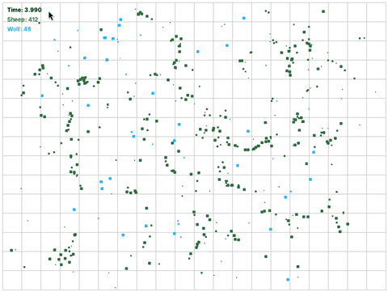
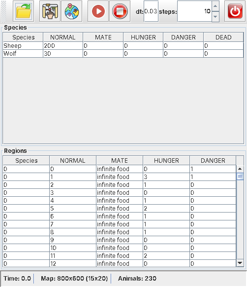

# Ecosystem Simulator

A Java desktop application that simulates a **predator–prey ecosystem**: sheep move around a map, eat, reproduce and try to escape, while wolves hunt them to survive. The population curves change in real time, so you can watch the ecosystem stabilise, explode or go extinct.

 



## Try it in 1 minute

1. Install Java 17 or newer (if `java -version` doesn't work, get it from [adoptium.net](https://adoptium.net)).
2. Download this repository: **Code → Download ZIP**, then unzip it.
3. In the unzipped folder, double-click **`EcosystemSimulator.jar`**, or run:

```bash
java -jar EcosystemSimulator.jar -i resources/examples/ex4.json
```

Press the map button to watch the animals, then ▶ to run. Other worlds are in `resources/examples/`.

| Control panel and statistics | Live map |
|---|---|
|  |  |

## Features

- **Graphical interface (Swing)** – control panel to load a configuration, start / stop the simulation, change the time step, open the map viewer and edit regions at runtime.
- **Live map viewer** – animals drawn on the map as they move, hunt and reproduce.
- **Statistics tables** – population per species and per state, and food per region, updated every step.
- **Configurable worlds** – map size, grid, animals and regions are described in JSON files (`resources/examples/`).
- **Batch mode** – run a simulation from the command line and write the final state to a JSON file.

## How it is built

The code follows a **Model–View–Controller** design and uses several classic design patterns:

| Pattern | Where |
|---|---|
| **Observer** | the GUI (`simulator.view`) subscribes to the simulator through `EcoSysObserver` and redraws on every change |
| **Factory + Builder** | `simulator.factories` creates animals, regions and strategies from JSON (`SheepBuilder`, `WolfBuilder`, `DynamicSupplyRegionBuilder`, ...) |
| **Strategy** | how an animal chooses a mate or prey: `SelectFirst`, `SelectClosest`, `SelectYoungest` |
| **Abstract classes / polymorphism** | `Animal` → `Sheep`, `Wolf`; `Region` → `DefaultRegion`, `DynamicSupplyRegion` |

```text
src/simulator/
├── launcher/     Main – command-line options, GUI or batch mode
├── control/      Controller – connects the model and the views
├── model/        Simulator, animals, regions, region manager
├── factories/    JSON → objects (Factory / Builder)
├── strategies/   selection strategies
├── view/         Swing GUI: main window, control panel, map, tables, dialogs
└── misc/         utilities (vectors, helpers)
```

## Run it

**Eclipse** (the repository is an Eclipse project): *File → Import → Existing Projects into Workspace*, then run `simulator.launcher.Main`.

**Build from source** (JDK 17+, from the repository root):

```bash
# compile (on Windows use ; instead of : in the classpath)
javac -d bin -cp "lib/*" $(find src/simulator -name "*.java")

# GUI mode with an example world (or simply: java -jar EcosystemSimulator.jar)
java -cp "bin:lib/*" simulator.launcher.Main -i resources/examples/ex1.json

# batch mode: simulate 10 seconds and save the result
java -cp "bin:lib/*" simulator.launcher.Main -m batch -i resources/examples/ex1.json -o out.json -t 10
```

| Option | Meaning |
|---|---|
| `-m gui` / `-m batch` | execution mode (default: GUI) |
| `-i <file>` | JSON configuration file (required in batch mode) |
| `-o <file>` | output file for batch mode |
| `-t <seconds>` | total simulation time |
| `-dt <seconds>` | time step |
| `-sv` | open the simple map viewer in batch mode |
| `-h` | help |

Libraries in `lib/`: Apache Commons CLI, `org.json` and a simple map viewer.

## Author

**Alexandra Rădulescu** – [GitHub](https://github.com/infinite-alex) · [LinkedIn](https://www.linkedin.com/in/alexandra-r%C4%83dulescu/)
